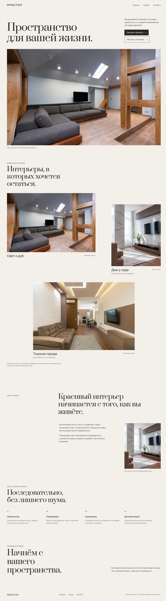
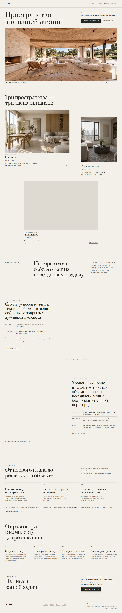
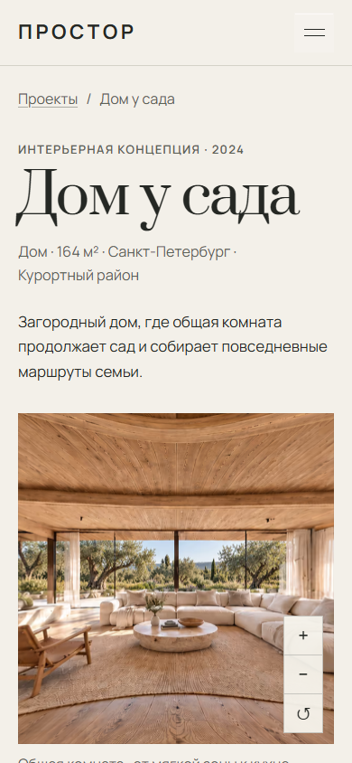
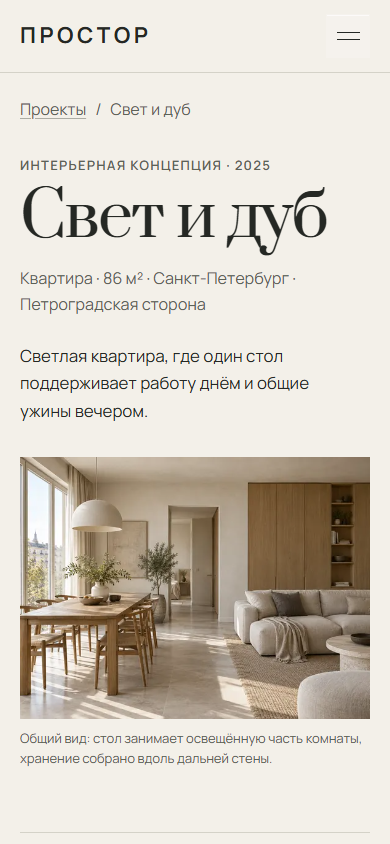

# PROSTOR: инженерный разбор статического сайта интерьерной студии

PROSTOR — многостраничный статический сайт с редакционной композицией, интерактивной 360°-панорамой, сопоставлением плана и пространства, каталогом проектов и последовательным сценарием подготовки обращения. Этот разбор отделён от публичного бренда студии: он описывает инженерные решения, проверяемые результаты и ограничения проекта для технического собеседования или оценки подрядчика.

Ключевой результат — 16 статических маршрутов с небольшим клиентским JavaScript, прогрессивными интерактивами и проверенной деградацией. Финальная production QA закрыла 264 из 264 проверок маршрутов в Chromium и WebKit; открытых P0/P1 не осталось. Это не означает подтверждённого коммерческого эффекта: конверсии и реальные пользовательские метрики не измерялись.

## Контекст

Исходная версия уже имела спокойную типографику, локальные изображения и базовый набор страниц. Но её структура ещё не объясняла ценность услуги через доказательства, интерактивы не связывали планировочное решение с результатом, а проверка ограничивалась несколькими маршрутами и размерами экрана.

Задача редизайна была не в добавлении эффектов ради эффекта. Нужно было собрать цельную историю от первого экрана до подготовки сводки, сохранить статическую архитектуру, сделать сложные визуальные элементы доступными без мыши и обеспечить работоспособность при отсутствии JavaScript, WebGL, View Transitions или отдельных media assets.

## Базовые проблемы

- Страницы выглядели как отдельные шаблоны, а не как одна система доказательств и действий.
- Визуальная история показывала изображения, но почти не объясняла связь между задачей, решением и результатом.
- Планировка и панорама существовали как потенциальные направления, но ещё не имели честного интерактивного контракта и fallback-поведения.
- Адаптивность проверялась точечно; не было полной route matrix, систематических no-JS, reduced-motion, forced-colors и cross-browser прогонов.
- Контент и технические обещания требовали строгой границы: нельзя было приписывать студии реальные объекты, отзывы, контакты или результаты, которых проект не подтверждает.

## Цели и ограничения

1. Сохранить статическую доставку и минимальный runtime вместо перехода к клиентскому SPA.
2. Сделать интерактивы прогрессивным улучшением: базовый контент и навигация должны работать без JavaScript.
3. Поддержать мышь, клавиатуру и touch, не блокируя вертикальный скролл на мобильном.
4. Использовать существующий визуальный язык и локальные assets; не маскировать недостающие бизнес-факты выдуманными данными.
5. Проверять root и `BASE_PATH=/prostor/`, потому что production-размещение находится в подпапке.
6. Удержать initial JavaScript заметно ниже внутреннего ориентира 50 КБ gzip.

## Системные решения

### Почему сохранены Astro и нативные API

Контент проекта в основном статичен, а интерактивность локальна. Astro оставляет маршруты обычными HTML-страницами, собирает responsive images на этапе build и позволяет подключать скрипты только там, где они нужны. Переход к React/Vue и постоянной hydration добавил бы runtime и состояния, не решая отдельной продуктовой проблемы.

Для поведения использованы нативные возможности браузера:

- Pointer Events для drag/touch с единым кодом ввода;
- WebGL2 для цилиндрической проекции 360°-текстуры;
- `ResizeObserver` для согласования canvas с реальным viewport;
- `IntersectionObserver` для независимого reveal групп с защитным таймаутом;
- History API для фильтра каталога и восстановления состояния Back/Forward;
- View Transitions API как необязательное улучшение обычной ссылки;
- Constraint Validation и Clipboard API с доступным readonly fallback без сервера и скрытой отправки данных.

Каждый API окружён проверкой поддержки. Если он недоступен, сохраняются ссылка, статичное изображение, полный контент или ручное копирование. Это уменьшает зависимость от полифиллов и делает отказ отдельной функции локальным, а не системным.

### Панорама

Панорама строится из одной цилиндрической текстуры. Fragment shader переводит луч экрана в longitude/vertical coordinate, а горизонтальная координата повторяется через `fract()`. Угол обзора ограничен диапазоном 60–105°, вертикальный наклон — ±8°.

Ввод разделён по намерению жеста. Для touch сначала применяется порог 10 px: преимущественно горизонтальный жест захватывает панорама, вертикальный остаётся странице. Клавиатура поддерживает стрелки, `+`, `-` и `Home`; состояние объявляется через live region. При `prefers-reduced-motion` инерция отключается и ракурс сбрасывается.

Media pipeline выпускает AVIF и WebP шириной 2048/4096/8192 px. WebGL переиспользует уже выбранный браузером `currentSrc`, поэтому не инициирует вторую параллельную загрузку. Если выбранная 8192-текстура не загружается, и статичный fallback, и WebGL однократно переходят на safe 4096 WebP. Именно этот сценарий был найден и закрыт как P1 на production QA.

### Сопоставление плана и пространства

`PlanToSpace` накладывает вид сверху на схему того же пространства, а не на декоративный псевдочертёж. Один процент управляет clip-границей, `aria-valuenow` и понятным `aria-valuetext`. Pointer-сценарий различает горизонтальное сравнение и вертикальный scroll; клавиши меняют значение на 5%, `Home` и `End` показывают крайние состояния. Без JavaScript обе подписанные стороны остаются в обычном потоке.

### Shared transition без роутера

Переход из карточки проекта в hero кейса использует уникальное имя по slug только для активированной карточки. Намерение хранится в `sessionStorage` не дольше 10 секунд и сверяется с целевым pathname. После перехода фокус переносится на H1. При отсутствии API или reduced motion остаётся обычная ссылка; собственный router и перехват навигации не добавлялись.

## Responsive strategy

Композиция строится на CSS Grid, fluid type/spacing tokens и содержательных breakpoint, а не на отдельной мобильной версии. Изображения получают явные размеры, `srcset`, `sizes`, loading и priority по положению в маршруте. На touch-интерактивах минимальные цели управления — 44×44 px.

Проверка охватывает 390×844, 768×1024 и 1440×900 для всех маршрутов; шесть критических страниц дополнительно проверены на 320×720, 1024×768 и 2560×1440. Отдельно проверялись text spacing, 200% zoom, landscape mobile и отсутствие горизонтального overflow.

## Доступность

- Один `main`, рабочий skip link и `aria-current` в breadcrumbs.
- Панорама имеет именованный region, инструкции, keyboard shortcuts и status updates.
- Plan-to-space использует доступный slider-контракт и дублирующие preset-кнопки.
- Hotspots закрываются `Escape` с возвратом фокуса.
- Формы имеют явные типы полей, видимый focus, сообщения об ошибках и no-JS порядок.
- Forced colors сохраняет focus/selected/open/invalid состояния.
- Reduced motion отключает reveal displacement, shared morph и инерцию панорамы.

Финальный accessibility gate: `axe-core 4.13.0` — 0 violations на 16 маршрутах после завершения reveal; keyboard 10/10, 200% zoom 6/6, forced colors 4/4, text spacing 16/16, no-JS 16/16 и reduced motion 16/16.

## Производительность

| Метрика | Проверенный результат | Комментарий |
| --- | ---: | --- |
| Initial JavaScript | 13 740 байт gzip | Ниже внутреннего ориентира 50 КБ |
| CSS | 21 619 байт gzip | Чистая root-сборка Stage 19 |
| HTML всех маршрутов | 119 694 байт gzip | 16 статических HTML |
| Панорама AVIF | 142 085 / 327 219 / 656 798 байт | 2048 / 4096 / 8192 px |
| CLS | ≤ 0,0283 | Mobile throttling Stage 19 |
| TBT | ≤ 93 мс | Mobile throttling Stage 19 |
| Наблюдаемый INP | ≤ 32 мс | Ограниченный автоматизированный прогон |
| LCP панорамного кейса | около 3,9 с | Видимое ограничение цельной 8192-текстуры |

Цифры не являются полевыми Core Web Vitals: это лабораторный прогон с ограничением сети и CPU. После добавления WebP fallback и preload локальных шрифтов cross-browser gate отдельно подтвердил CLS 0 на пяти ключевых маршрутах, TBT до 162 мс и observed INP до 40 мс в своём профиле.

## QA и надёжность

Production QA собирала root и `/prostor/` с чистого состояния. В Chromium 154.0.8037.99 и WebKit 26.5 прошли:

- 264/264 route checks;
- 16 маршрутов, включая 404, без broken images, missing alt, скрытых reveal-секций и horizontal overflow;
- menu, filter/history, panorama, plan splitter, hotspots, FAQ, calculator prefill и form review/edit;
- keyboard, touch, Back/Forward, direct deep links, slow network, blocked high-resolution texture, no-JS и reduced motion;
- статический аудит 198 файлов: missing refs=0, без localhost, source maps, секретов и рабочих документов в release.

### До и после

Baseline фиксирует раннюю рабочую версию, а итоговый кадр — композицию после системного редизайна. Это не A/B-тест и не доказательство роста конверсии.

| Ранняя версия | Итоговая версия |
| --- | --- |
|  |  |

Выбранные состояния интерактивов:

| Панорама на touch | План и пространство на touch |
| --- | --- |
|  |  |

## Карта файлов и компонентов

| Зона | Файлы | Ответственность |
| --- | --- | --- |
| Маршруты | `src/pages/**/*.astro` | 16 статических HTML, content composition, 404, robots и sitemap |
| Общий shell | `src/layouts/BaseLayout.astro` | metadata, fonts, header/footer, reveal и progressive enhancement |
| Данные | `src/data/projects.ts`, `src/data/services.ts`, `src/data/site.ts` | типизированное содержимое проектов, услуг и общих разделов |
| Панорама | `PanoramaSurface.astro`, `panorama.ts` | responsive texture selection, WebGL2, input, fallback и recovery |
| Plan-to-space | `PlanToSpace.astro`, `plan-to-space.ts` | семантика, сравнение слоёв, pointer/keyboard state |
| Переходы | `ProjectCard.astro`, `project-transitions.ts` | обычные ссылки с optional shared transition и focus handoff |
| Формы | `ProjectCalculator.astro`, `DemoInquiry.astro`, `calculator.ts`, `demo-inquiry.ts` | локальный prefill, validation, review и ручная передача сводки |
| Проверка | `scripts/audit-performance.mjs`, `output/playwright/*` | статические бюджеты, browser matrices и evidence artifacts |

## Результат

Проект остался статическим и понятным в эксплуатации, но получил сложные интерактивы с явными fallback-контрактами. Архитектура не требует клиентского фреймворка или сервера, а route/content model позволяет добавлять проекты и услуги через данные и общие компоненты. Проверка стала частью инженерного результата: ограничения и найденный P1 зафиксированы так же явно, как успешные сценарии.

## Ограничения

- LCP панорамного кейса около 3,9 с остаётся ценой цельной 8192-текстуры; tiling не реализован.
- Автоматизированный WebKit не заменяет проверку на физическом Safari/iPhone.
- Лабораторные performance-метрики не являются RUM и не доказывают поведение реальной аудитории.
- Конверсии, число пользователей и коммерческий результат не измерялись.
- Цены, география, кейсы и границы услуг — сценарное содержимое; будущий владелец должен подтвердить их до коммерческого использования.
- Сайт не имеет backend: сводка остаётся в браузере и передаётся только явным действием пользователя.

## Воспроизводимая проверка

```powershell
npm ci --no-audit --no-fund
npm run check
npm run build
npm run audit:performance
$env:BASE_PATH='/prostor/'; npm run build; Remove-Item Env:BASE_PATH
```

Полные отчёты Stage 18, Stage 19 и master Stage 21 находятся в локальной папке `output/playwright/`. Она намеренно исключена из public build; выбранные скриншоты выше скопированы в `references/qa/stage-22/` как компактное проверяемое приложение к кейсу.
